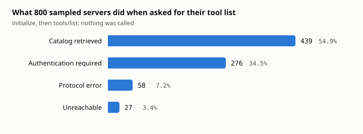
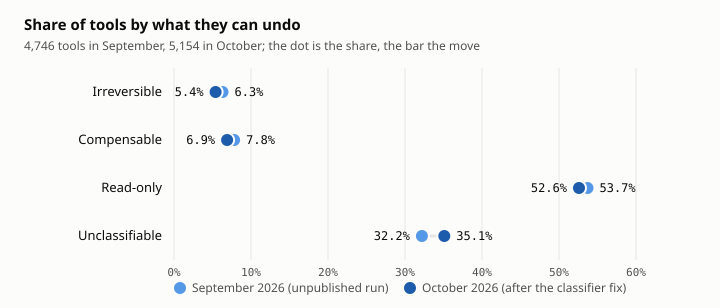
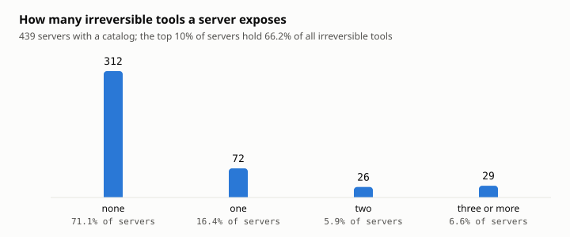

# More than one public MCP server in four can do something nobody can undo

*A scan of 800 servers from the public MCP registry, October 2026. By Rinsoft.*

*We build [RinWall](../README.md), an open-source firewall that sits between AI agents and the
tools they call, and sorts those tools by whether their effects can be undone. The classifier
behind every number below is the one inside RinWall, so the section on its error rate is also
a check on our own product.*

An AI agent that calls tools can read things and it can do things. Reading is cheap to get
wrong. Doing is not: a sent email, a payment, a deleted volume, a published post. Most of
the agent incidents reported so far follow one pattern: the agent read something it should
not have trusted, then took an action nobody could take back.

We wanted to know two things, and couldn't find anyone who had measured them. Of the tools
agents are actually being given, how many take an action that cannot be undone? And how
often does a single server give an agent both the content to read and the action to take?

## How the sample was drawn

The official MCP registry has a public API, so no code was downloaded or run. We paged it
with its own latest-version filter and kept servers marked active that advertise a
Streamable HTTP endpoint:

| Funnel stage | October 2026 | September 2026 (earlier, unpublished run) |
|---|---|---|
| Listed (latest versions) | 48,003 | |
| Active | 47,389 | 29,724 |
| With a Streamable HTTP endpoint | 30,767 | 17,032 |
| Distinct hosts | 22,356 | 11,835 |
| After capping 3 endpoints per host | 23,259 | |
| **Sampled** (seed 20260909) | **800** | **800** |

The per-host cap matters. A few aggregator hosts publish over a thousand endpoints each;
sampling in proportion would hammer one operator and let one provider's naming conventions
stand in for the ecosystem. The cap worked: the 439 servers that returned a catalog came from
439 distinct hosts.

Each server received exactly what one `tools/list` requires: `initialize`, then
`tools/list`. Never a `tools/call`, no retries into failure, a `clientInfo` that names the
scanner, and an authentication challenge recorded as a result rather than worked around. The scanner has a
test asserting it never emits `tools/call`.

## A third of servers want credentials first

| Outcome | n | share |
|---|---|---|
| Catalog retrieved | 439 | 54.9% |
| Authentication required | 276 | 34.5% |
| Protocol error | 58 | 7.2% |
| Unreachable | 27 | 3.4% |



More than a third of publicly registered servers want credentials before they will even list
their tools. That group likely includes many enterprise integrations, which is where tools
that move money and delete records tend to live. So the numbers below probably understate
the risk, and anyone quoting them should say so.

## What the tools do

Each tool was classified by what it can undo, from its name, its author-written description
and its schema. Three classes: **irreversible** (sent, paid, deleted, published), **compensable**
(a mutation with a natural inverse: an update, an assignment, a created record) and
**read-only**. A fourth bucket, **unclassifiable**, is where the heuristic declines to guess.

Across 5,154 tools from 439 servers (median 6 tools per server, largest catalog 223):

| Class | tools | share | 95% CI |
|---|---|---|---|
| Irreversible | 278 | 5.4% | 4.8–6.0 |
| Compensable | 355 | 6.9% | 6.2–7.6 |
| Read-only | 2,710 | 52.6% | 51.2–53.9 |
| Unclassifiable | 1,811 | 35.1% | 33.8–36.5 |



One catalog of 223 tools contributes 171 of the unclassifiable ones by itself. Without it the
unclassifiable share is 33.3% and the irreversible share 5.5%; the server-level figures
below are unaffected, since each server counts once.

## Where the risk sits

Per-server numbers matter more than per-tool ones, because an agent connected to a server
gets all of its tools.

- **28.9% of servers** (127 of 439) expose at least one irreversible tool.
- **25.7%** (113) are entirely read-only.
- **27.6%** (121) expose both reads and at least one irreversible action.

That last group is the classic confused-deputy setup: one server, one session, an agent
that can read attacker-controlled content and take an action nobody can undo, with nothing
between the two but the model's own judgement.

The risk is also concentrated. The worst 10% of servers (44 of them) hold **66.2%** of all
irreversible tools, and 29 servers expose three or more.



## How often the classifier is wrong

We checked the classifier by hand: a seeded, stratified sample of 75 classifications, each
reviewed against the tool's real description. The first pass did badly on irreversible
tools:

| Class | reviewed | correct | first-pass precision |
|---|---|---|---|
| Irreversible | 20 | 11 | 55% |
| Compensable | 20 | 18 | 90% |
| Read-only | 20 | 20 | 100% |

Six of the nine irreversible misses were one bug. The table of irreversible verbs contains
words that are at least as often nouns: *post*, *email*, *release*, *refund*, *pay*, *file*.
That table matched anywhere in a name, so `get_post` read as "posts externally" and
`verify_email` as "sends email". The fix is narrow: when the leading verb is a recognized
read or compensable verb, such a word after it is the object, not a second action.
Destructive and outbound verbs (`delete`, `send`, `publish`) still match anywhere, so
`get_and_delete_backups` stays gated, and a name with no recognized verb in front
(`how_to_pay`) still fails closed.

Re-running the classifier over the stored catalogs (no further requests to anyone) moved 45
tools out of the irreversible class, 34 to read-only and 11 to compensable, and a fresh
sample gave:

| Class | reviewed | correct | precision after the fix |
|---|---|---|---|
| Irreversible | 20 | 16 | 80% |
| Compensable | 20 | 19 | 95% |
| Read-only | 20 | 20 | 100% |

The figures in this post are the post-fix numbers. Two things held in both passes. **No
read-only classification was wrong**: not one tool classified as a read turned out to take
an action. And every remaining irreversible miss was over-classification, which is the
direction the classifier is built to fail in: a false "irreversible" costs an approval
click; a false "read-only" costs a sent email.

The unclassifiable bucket is not harmless either. Of 30 unclassifiable
tools we reviewed, 16 were reads, 9 were compensable mutations, and **5 were irreversible**:
among them `place_order` ("Real funds"), a webhook replay, and a tool that starts automated
outreach to insurance payers. Assuming "noun-shaped name means read" would have waved those
through. The bucket is dominated by names with no verb at all (`crypto_price`, `nftOwner`,
`free_tiers`) and by namespace-prefixed vendor catalogs.

## Other findings

**Authors do warn, and the warning is machine-readable.** 39 of the 278 irreversible tools
were flagged by their own description ("permanently", "cannot be undone") rather than by any
verb. Every one of the 5,154 tools shipped a description. A classifier that only reads tool
names misses these.

**Reads can cost money.** Three of the 20 read-only tools we reviewed charge per call via
x402 micropayments, with prices from $0.003 to $0.05. The read itself has no side effect,
spending from the agent's wallet does. RinWall's three classes don't account for that cost
yet.

**The registry is growing quickly.** Active servers grew from 29,724 to 47,389 between the two
scans, six weeks apart.

## The same method, six weeks earlier

The pipeline was first run in September 2026, while the classifier was still being built.
That run was never published; it is reported here because an independent re-sample of a
registry that had since grown by 59% landed within the confidence intervals, which suggests
the method is measuring something stable rather than noise. Same seed, same method,
different sample:

| | September 2026 (unpublished run) | October 2026 |
|---|---|---|
| Catalogs retrieved | 421 (52.6%) | 439 (54.9%) |
| Authentication required | 257 (32.1%) | 276 (34.5%) |
| Irreversible tools | 6.3% | 5.4% |
| Compensable | 7.8% | 6.9% |
| Read-only | 53.7% | 52.6% |
| Unclassifiable | 32.2% | 35.1% |
| Servers with ≥1 irreversible tool | 32.5% | 28.9% |
| Servers with reads and irreversible | 30.9% | 27.6% |
| Top decile's share of irreversible tools | 66% | 66.2% |
| Flagged by author's own description | 38 | 39 |

The October irreversible figures are lower by roughly a point because of the classifier fix
above, which the September scan did not have. Everything else moved within its confidence
interval.

## Limitations

The classifier is a heuristic over names and descriptions, hand-validated at the precision
above, not ground truth. A third of tools are unclassifiable and are reported as such rather
than smoothed over. Authenticated servers, the likeliest home of the most dangerous tools,
are invisible to this method. A tool's description can lie. And "irreversible" is a property
of the action, not of the agent: a well-aligned model will decline most bad calls on its own.
This scan doesn't measure how often models get it wrong, only how many servers give them the
chance.

## What to do with it

**Measure your own.** If you run an MCP server, classify your own catalog. If you connect an
agent to someone else's, classify theirs. The scanner this post is built on does that in one
command, calls nothing, and prints the signals behind every classification so you check the
reasoning rather than trust a label:

```bash
go run ./cmd/blastradius --mcp https://example.com/mcp
```

**Then put something between the agent and the irreversible tools.** That is what we built
RinWall for. It uses the same three classes as a policy. Reads go straight through. Changes that
can be undone go through, and are reversed automatically if a later step in the same run fails.
Actions that can't be undone wait until a person approves that exact request. Tools it can't
classify, a third of them in this scan, it treats as irreversible until someone reviews them. It
runs in front of an existing MCP server with one command and no configuration:

```bash
rinwall --mcp https://your-server.example.com/mcp
```

It doesn't make the model any smarter. On servers that let an agent read untrusted content and
take an irreversible action, it means the model's judgement is no longer the only thing in the
way. The [README](../README.md) has the two-minute setup; RinWall is
Apache-2.0.

## Reproduce it

```bash
python scripts/sample_registry.py --out research/servers.txt --summary research/registry_summary.json
go run ./cmd/blastradius --targets research/servers.txt --json --save-catalogs > research/corpus.json
python scripts/analyze_corpus.py research/corpus.json --registry-summary research/registry_summary.json
```

The registry funnel, the computed analysis with confidence intervals, and all 75
hand-reviewed classifications with their verdicts are in this repository's `research/`
directory. The raw catalogs are not published: this write-up carries aggregates and the
pipeline to reproduce them, not a list of named third-party servers.
